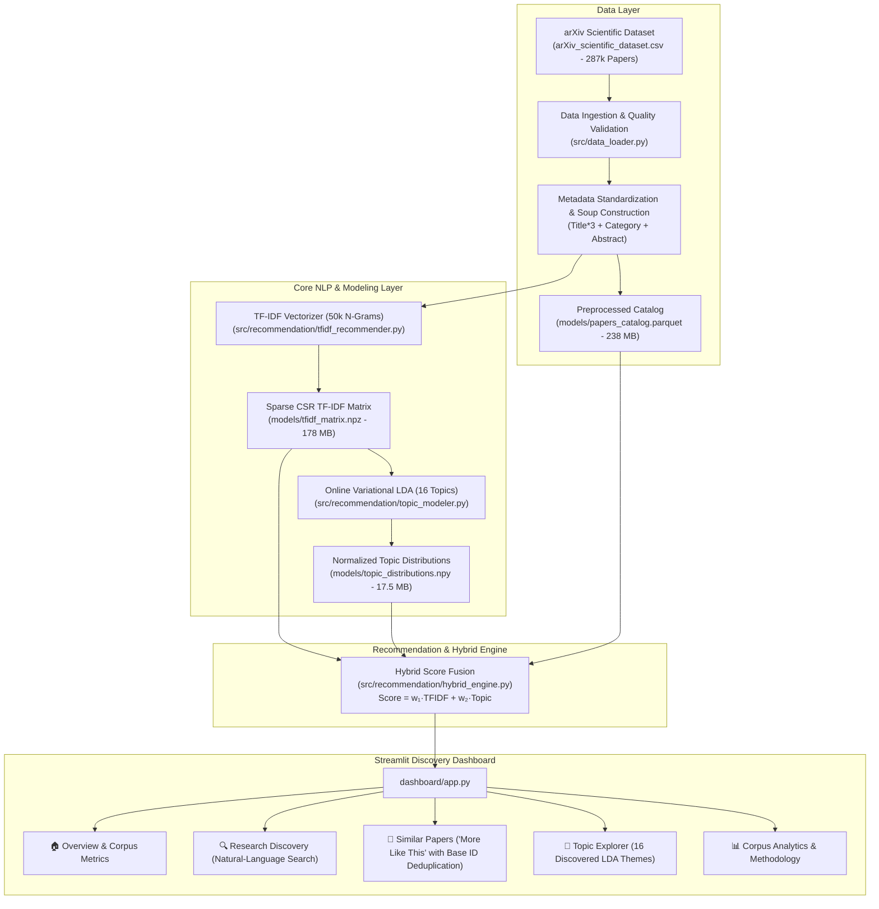

<div align="center">

# 🔬 LitLens — Intelligent Research Paper Recommendation & Discovery System

[](https://www.python.org/)
[](https://streamlit.io/)
[](https://scikit-learn.org/)
[](LICENSE)

**An interpretable, multi-arm scientific paper recommendation engine and interactive discovery dashboard indexing 287,421 arXiv research papers.**

</div>

---

## 📖 Overview

**LitLens** is a modern NLP-powered discovery platform designed for researchers, engineers, and academics. Navigating the exponential expansion of scientific literature requires both **precise lexical retrieval** and **latent conceptual topic modeling**. 

LitLens combines:
1. **Content-Based Sparse TF-IDF (Unigrams + Bigrams):** High-precision phrase and keyword retrieval with sublinear term-frequency scaling and title-weighted metadata representation.
2. **Latent Dirichlet Allocation (LDA):** Unsupervised discovery of 16 scientific themes (LLMs, Computer Vision, Reinforcement Learning, Graph Neural Networks, Adversarial ML, etc.) trained via online variational inference.
3. **Explainable Hybrid Fusion:** User-tunable linear score combination exposing constituent TF-IDF and Topic scores, key shared technical concepts, and dominant topic clusters.
4. **Interactive Streamlit Dashboard:** An academic dark-mode web application featuring publication trend analytics, "More Like This" paper search with version deduplication, and topic exploration.

---

## 🏛️ System Architecture



---

## 🚀 Key Features

* **Natural-Language Research Discovery:** Free-text semantic queries against all 287k papers with real-time score contribution breakdowns and tunable weights.
* **"More Like This" Seed Paper Search:** Recommends related works while strictly excluding duplicate revisions (papers sharing `base_id`).
* **Metadata & Temporal Filtering:** Filter recommendations by scientific category and publication year range (1993–2026).
* **Transparent Explainability:** Displays constituent TF-IDF and Topic scores separately and extracts exact overlapping terms ($c_j = q_j \cdot d_{ij}$).
* **Topic Cluster Explorer:** Interactive inspection of 16 unsupervised LDA topics, keyword distributions, and top representative papers.
* **Corpus Analytics:** Interactive Plotly charts for publication trends, category distributions, and decade histograms.
* **Low Latency & High Memory Efficiency:** Operates strictly on sparse matrices (`scipy.sparse.csr_matrix`), executing single-query cosine similarities in **sub-50ms** without allocating dense pairwise matrices.

---

## 📂 Project Structure

```
LitLens/
├── dashboard/                     # Streamlit discovery application
│   ├── app.py                     # Main dashboard entrypoint & page router
│   ├── components/                # Reusable UI components
│   │   ├── cards.py               # Academic paper cards & KPI widgets
│   │   ├── charts.py              # Plotly dark-theme visualizers
│   │   └── styles.py              # Modern dark CSS styling
│   └── pages/                     # Modular section views
│       ├── overview.py            # Corpus stats & system architecture
│       ├── discovery.py           # Natural-language hybrid query search
│       ├── similar_papers.py      # Seed paper similarity with version deduplication
│       ├── topic_explorer.py      # 16 LDA topics inspection & discovery
│       └── analytics.py           # Publication trends & category insights
├── data/
│   └── arXiv_scientific_dataset.csv # Raw dataset (287,421 records, preserved unmodified)
├── models/                        # Serialized model artifacts
│   ├── papers_catalog.parquet     # Compressed metadata catalog (238 MB)
│   ├── tfidf_vectorizer.pkl       # Fitted 50k-vocabulary vectorizer (1.89 MB)
│   ├── tfidf_matrix.npz           # Sparse CSR matrix (178 MB)
│   ├── tfidf_metadata.pkl         # ID mappings & filtering arrays (9 MB)
│   ├── lda_model.pkl              # Fitted online LDA model (0.62 MB)
│   ├── topic_distributions.npy    # L2-normalized topic matrix (17.5 MB)
│   └── topic_metadata.pkl         # Topic labels and keyword distributions (9 MB)
├── reports/                       # Formal quality and evaluation reports
│   ├── dataset_quality_report.md  # Dataset validation and quality audit
│   ├── phase2_indexing_report.md  # Indexing benchmarks & mathematical formulation
│   └── phase3_evaluation_report.md# 5-query qualitative evaluation & benchmark
├── scripts/                       # Reproducible pipelines
│   ├── run_indexing.py            # Phase 2 dataset ingestion & TF-IDF indexing
│   ├── train_topic_model.py       # Phase 3 LDA training & topic projection
│   └── evaluate_recommendations.py# 5-domain qualitative evaluation benchmark
├── src/                           # Core business logic package
│   ├── data_loader.py             # Schema validation & quality auditing
│   ├── preprocessing.py           # Domain text cleaning & soup engineering
│   ├── recommendation/            # Recommendation algorithms
│   │   ├── tfidf_recommender.py   # Sparse TF-IDF cosine retrieval
│   │   ├── topic_modeler.py       # Online LDA topic engine
│   │   └── hybrid_engine.py       # Fused score engine with explainability
│   └── utils/
│       └── metrics.py             # Memory & execution time profiling
├── tests/                         # Automated test suite (39 tests)
│   ├── test_data_loader.py        # Ingestion & schema validation tests
│   ├── test_preprocessing.py      # Text cleaning & soup tests
│   ├── test_tfidf_recommender.py  # TF-IDF sparse retrieval tests
│   ├── test_topic_modeler.py      # LDA topic distribution tests
│   ├── test_hybrid_recommender.py # Hybrid score fusion & filtering tests
│   ├── test_dashboard_integration.py # Dashboard components & chart tests
│   └── test_pipeline_integration.py  # Full 287k artifact parity tests
├── LICENSE                        # MIT License with original BookMind attribution
├── NOTICE.md                      # Detailed component lineage documentation
└── requirements.txt               # Project dependencies
```

---

## 🛠️ Installation & Setup

### 1. Prerequisites
* Python 3.10+ (tested on Python 3.10, 3.11, 3.12, and 3.13)
* Git

### 2. Clone Repository & Install Dependencies
```bash
git clone https://github.com/your-username/LitLens.git
cd LitLens

# Create virtual environment (optional but recommended)
python -m venv .venv
# Activate on Windows:
.venv\Scripts\activate
# Activate on Linux/macOS:
source .venv/bin/activate

# Install dependencies
pip install -r requirements.txt
```

### 3. Launch Streamlit Discovery Dashboard
```bash
python -m streamlit run dashboard/app.py
```
Or directly:
```bash
streamlit run dashboard/app.py
```
Open **`http://localhost:8501`** in your browser.

---

## 🧪 Running Automated Tests

LitLens includes 39 comprehensive unit and integration tests covering data validation, preprocessing, sparse matrix operations, topic modeling, hybrid fusion, and UI charts:

```bash
python -m unittest discover -s tests -p "test_*.py"
```
*Expected Result:* `Ran 39 tests ... OK`

---

## 🔬 NLP Methodology & Mathematical Models

### 1. Title-Weighted Text Representation ("Soup")
Scientific titles convey the highest semantic density. The text representation weights titles $3\times$ while including categories and abstract text:
$$\text{Soup}(d) = \underbrace{(Title(d) \oplus \dots \oplus Title(d))}_{3\times} \oplus Category(d) \oplus Summary(d)$$

### 2. Sparse TF-IDF Lexical Retrieval
* **Sublinear Scaling:** $\text{tf}_{\text{sub}}(t, d) = 1 + \ln(\text{tf}(t, d))$ prevents repetitive abstract keywords from dominating.
* **Smooth IDF:** $\text{idf}(t, D) = \ln\left(\frac{1 + |D|}{1 + \text{df}(t, D)}\right) + 1$.
* **Cosine Similarity:** Since vectors are $L_2$-normalized onto the unit hypersphere ($\|\vec{v}\|_2 = 1$), cosine similarity simplifies to a sparse dot product:
  $$\text{Score}_{\text{tfidf}}(\vec{q}, \vec{d}_i) = \vec{q} \cdot \vec{d}_i$$

### 3. Latent Dirichlet Allocation (Topic Arm)
Online Variational Bayes decomposes papers into mixtures of 16 latent topics. Each document topic vector is $L_2$-normalized:
$$\vec{\hat{\theta}}_d = \frac{\vec{\theta}_d}{\|\vec{\theta}_d\|_2} \implies \text{Score}_{\text{topic}}(\vec{\hat{\theta}}_q, \vec{\hat{\theta}}_i) = \vec{\hat{\theta}}_q \cdot \vec{\hat{\theta}}_i \in [0, 1]$$

### 4. Hybrid Score Fusion
$$\text{Score}_{\text{hybrid}} = w_{\text{tfidf}} \cdot \text{Score}_{\text{tfidf}} + w_{\text{topic}} \cdot \text{Score}_{\text{topic}}$$
* Default weights: $w_{\text{tfidf}} = 0.60$, $w_{\text{topic}} = 0.40$ (user-tunable).
* Cosine and topic similarity scores are geometric alignment measures, **never presented as probabilities or prediction accuracies**.

---

## ⚖️ Attribution & Lineage

* **Reference Project:** Structural UI patterns, dark CSS styling, and dashboard caching concepts are derived from [BookMind](https://github.com/NumiKun/Book-Recommendation-System) by NumiKun (MIT License, Copyright 2026). Complete component lineage is documented in [`NOTICE.md`](NOTICE.md).
* **Dataset:** Preprocessed metadata from the public arXiv scientific corpus (Cornell University). All original papers are attributed via active `arXiv:{id}` links.

---

## ⚠️ Known Limitations

1. **Lexical Vocabulary Boundary:** While LDA bridges broad themes, the TF-IDF arm requires overlapping vocabulary tokens. Synonyms with zero token overlap rely primarily on the topic arm.
2. **Pre-Embedding Stage:** Dense semantic embeddings (e.g. Sentence-Transformers) are not yet integrated into the hybrid arm.
3. **Large Artifact GitHub Pushing:** The Parquet catalog (238 MB) and sparse matrix (178 MB) exceed GitHub's standard 100 MB single-file limit; they are maintained locally or tracked via Git LFS.

